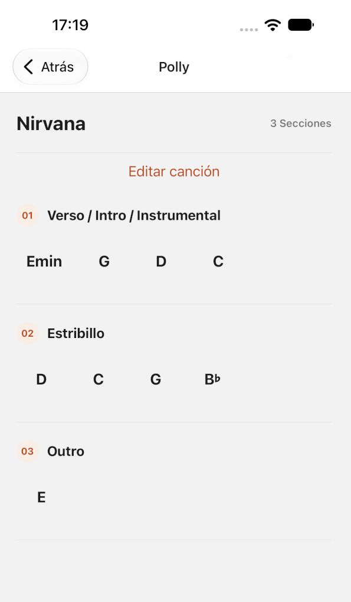
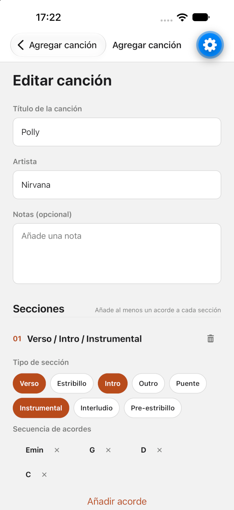

# minichords

This app solves the problem of me need a catalog of summaries of the chord progressions for songs I like to play on the guitar. Guitar tabs apps tend to be way to bloated, full of ads, expensive, and just display too much. I also need to keep my hands on the guitar, not scrolling my phone. This project was created with React Native and will hopefully be released very soon!

## License notes

This repository is publicly visible for reference and demonstration purposes.
No license is granted for use, copying, modification, or distribution of the source code.
All rights reserved.
